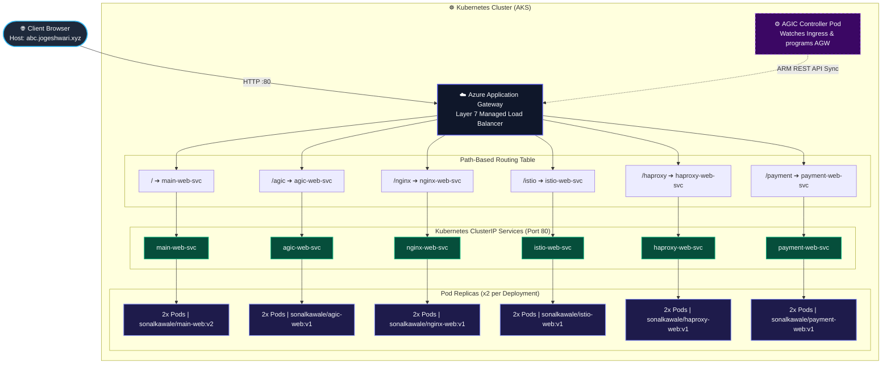

<div align="center">

# ☸️ Kubernetes Ingress Controllers Master Hub
### *Production-Grade Layer 7 Ingress Routing, Service Mesh & Multi-Microservice Practice Lab*

[](https://kubernetes.io/)
[](https://www.docker.com/)
[](https://azure.github.io/application-gateway-kubernetes-ingress/)
[](https://nginx.org/)
[](https://istio.io/)
[](https://www.haproxy.org/)
[](LICENSE)

<br/>

[🚀 Quick Start](#-quick-start--deployment) • [📐 Architecture](#-architecture--traffic-flow) • [📊 Routing Matrix](#-microservices--routing-matrix) • [⚖️ Controller Comparison](#-ingress-controller-comparison) • [📦 Docker Images](#-building--pushing-docker-images) • [❓ Troubleshooting](#-troubleshooting)

<br/>

```
      _                       _                         _  ____  
     | | ___   __ _  ___  ___| |____      ____ _ _ __ (_)|___ \ 
  _  | |/ _ \ / _` |/ _ \/ __| '_ \ \ /\ / / _` | '__|| |  __) |
 | |_| | (_) | (_| |  __/\__ \ | | \ V  V / (_| | |   | | / __/ 
  \___/ \___/ \__, |\___||___/_| |_|\_/\_/ \__,_|_|   |_||_____|
              |___/                                             
              ☸️ CLOUD-NATIVE INGRESS ARCHITECTURE LAB ☸️
```

<p align="center">
  <b>Domain Entrypoint:</b> <code>abc.jogeshwari.xyz</code> &nbsp;|&nbsp;
  <b>Target Platform:</b> Azure Kubernetes Service (AKS) & Application Gateway
</p>

</div>

---

> [!NOTE]
> **About This Repository**: An end-to-end, hands-on Kubernetes practice environment showcasing **Layer 7 path-based routing**, dynamic path rewrites, containerized microservices, and deep-dive technical architectures comparing the industry's four leading Ingress controllers: **Azure AGIC**, **NGINX Ingress**, **Istio Service Mesh Gateway**, and **HAProxy Ingress**, plus an interactive **Payment Gateway** demo.

---

## 📑 Table of Contents

- [🌟 Architectural Highlights](#-architectural-highlights)
- [📐 Architecture & Traffic Flow](#-architecture--traffic-flow)
- [🧩 Deployed Services Showcase](#-deployed-services-showcase)
- [📊 Microservices & Routing Matrix](#-microservices--routing-matrix)
- [⚖️ Ingress Controller Comparison](#-ingress-controller-comparison)
- [📁 Repository Structure](#-repository-structure)
- [🛠️ Prerequisites](#-prerequisites)
- [🚀 Quick Start & Deployment](#-quick-start--deployment)
- [🌐 DNS & Host Resolution](#-dns--host-resolution)
- [🔍 Testing & Verification](#-testing--verification)
- [🔄 Adapting for Other Ingress Controllers](#-adapting-for-other-ingress-controllers)
- [📦 Building & Pushing Docker Images](#-building--pushing-docker-images)
- [❓ Troubleshooting Guide](#-troubleshooting-guide)
- [👤 Author & Credits](#-author--credits)

---

## 🌟 Architectural Highlights

<table>
  <tr>
    <td width="50%" valign="top">
      <h4>⚡ Intelligent Layer 7 Routing</h4>
      <ul>
        <li>Routes an entire distributed application suite behind a <b>single external IP / DNS hostname</b> (<code>abc.jogeshwari.xyz</code>).</li>
        <li>Eliminates the cost and operational overhead of provisioning dedicated cloud load balancers per service.</li>
      </ul>
    </td>
    <td width="50%" valign="top">
      <h4>🔄 Automated Path Rewriting</h4>
      <ul>
        <li>Leverages <code>appgw.ingress.kubernetes.io/backend-path-prefix: "/"</code>.</li>
        <li>Allows clients to reach microservices at distinct subpaths (e.g. <code>/payment</code>, <code>/agic</code>) while upstream pods cleanly receive requests at root <code>/</code>.</li>
      </ul>
    </td>
  </tr>
  <tr>
    <td width="50%" valign="top">
      <h4>🛡️ Enterprise Security & WAF Ready</h4>
      <ul>
        <li>Integrates with Azure Application Gateway WAF v2 for real-time inspection against OWASP Top 10 vulnerabilities.</li>
        <li>Edge TLS/SSL termination offloads intensive cryptographic handshakes from application pods.</li>
      </ul>
    </td>
    <td width="50%" valign="top">
      <h4>📦 Resource-Bounded Microservices</h4>
      <ul>
        <li>6 distinct containerized services (<b>12 pods total</b>) built on lightweight <code>nginx:alpine</code>.</li>
        <li>Each deployment is hardened with explicit CPU/Memory <code>requests</code> and <code>limits</code> for cluster stability.</li>
      </ul>
    </td>
  </tr>
</table>

<div align="right"><a href="#-table-of-contents">⬆ Back to Top</a></div>

---

## 📐 Architecture & Traffic Flow



### 🔁 Request Lifecycle Step-by-Step
1. **DNS Resolution**: The browser resolves `abc.jogeshwari.xyz` to the public VIP of the Azure Application Gateway.
2. **Path Matching**: Application Gateway inspects the incoming URI prefix (e.g. `/payment`, `/istio`, or `/`).
3. **URL Rewrite**: The `appgw.ingress.kubernetes.io/backend-path-prefix: "/"` annotation strips the prefix.
4. **Pod Forwarding**: Traffic is sent directly to internal Pod IP addresses using Azure CNI high-speed overlay.
5. **Response Delivery**: The response is returned to the user with low latency and zero unnecessary intermediate hops.

<div align="right"><a href="#-table-of-contents">⬆ Back to Top</a></div>

---

## 🧩 Deployed Services Showcase

<table>
  <tr>
    <td align="center" width="33%">
      <br/>
      <b><code>/</code> Main Web Hub</b>
      <p>Central dashboard introducing ingress controller fundamentals, control loop mechanics, and direct navigation links.</p>
    </td>
    <td align="center" width="33%">
      <br/>
      <b><code>/agic</code> Azure AGIC</b>
      <p>Direct CNI pod routing, ARM API controller mechanics, Azure WAF v2 security policies, and enterprise integration patterns.</p>
    </td>
    <td align="center" width="33%">
      <br/>
      <b><code>/nginx</code> NGINX Ingress</b>
      <p>The global community standard. Explores annotations, dynamic Lua scripting, regex location matching, and cert-manager SSL.</p>
    </td>
  </tr>
  <tr>
    <td align="center" width="33%">
      <br/>
      <b><code>/istio</code> Istio Gateway</b>
      <p>Envoy proxy architecture, decoupling L4-L6 (Gateway CRD) and L7 (VirtualService CRD), zero-trust mTLS, and canary traffic weighting.</p>
    </td>
    <td align="center" width="33%">
      <br/>
      <b><code>/haproxy</code> HAProxy Ingress</b>
      <p>Extreme speed, microsecond latency, 2M+ concurrent connection scalability, dynamic runtime socket reloads, and DDoS resilience.</p>
    </td>
    <td align="center" width="33%">
      <br/>
      <b><code>/payment</code> Payment Service</b>
      <p>Interactive simulated checkout interface demonstrating real-world path routing with custom Nginx fallback configuration.</p>
    </td>
  </tr>
</table>

<div align="right"><a href="#-table-of-contents">⬆ Back to Top</a></div>

---

## 📊 Microservices & Routing Matrix

| Route Path | K8s Service | Deployment Name | Pods | Docker Image | Requests (CPU / Mem) | Limits (CPU / Mem) | Port | Health Status |
|:---|:---|:---|:---:|:---|:---:|:---:|:---:|:---:|
| `GET /` | `main-web-svc` | `main-web-deployment` | `2` | `sonalkawale/main-web:v2` | `50m` / `64Mi` | `250m` / `128Mi` | `80` | `🟢 Live` |
| `GET /agic` | `agic-web-svc` | `agic-web-deployment` | `2` | `sonalkawale/agic-web:v1` | `50m` / `64Mi` | `250m` / `128Mi` | `80` | `🟢 Live` |
| `GET /nginx` | `nginx-web-svc` | `nginx-web-deployment` | `2` | `sonalkawale/nginx-web:v1` | `50m` / `64Mi` | `250m` / `128Mi` | `80` | `🟢 Live` |
| `GET /istio` | `istio-web-svc` | `istio-web-deployment` | `2` | `sonalkawale/istio-web:v1` | `50m` / `64Mi` | `250m` / `128Mi` | `80` | `🟢 Live` |
| `GET /haproxy` | `haproxy-web-svc` | `haproxy-web-deployment` | `2` | `sonalkawale/haproxy-web:v1` | `50m` / `64Mi` | `250m` / `128Mi` | `80` | `🟢 Live` |
| `GET /payment` | `payment-web-svc` | `payment-web-deployment` | `2` | `sonalkawale/payment-web:v1` | `50m` / `64Mi` | `250m` / `128Mi` | `80` | `🟢 Live` |

> [!IMPORTANT]
> **Total Footprint**: Deploying the entire stack spins up **12 lightweight Pods**, consuming an initial request baseline of only **300m CPU** and **384Mi Memory**, making it suitable for any development or production AKS cluster.

<div align="right"><a href="#-table-of-contents">⬆ Back to Top</a></div>

---

## ⚖️ Ingress Controller Comparison

An architectural cheat sheet contrasting the 4 major Kubernetes Ingress controllers covered in this project:

```
┌─────────────────────┬───────────────────┬───────────────────┬───────────────────┬───────────────────┐
│ Feature / Dimension │    Azure AGIC     │   NGINX Ingress   │   Istio Gateway   │  HAProxy Ingress  │
├─────────────────────┼───────────────────┼───────────────────┼───────────────────┼───────────────────┤
│ Data Plane Proxy    │ Azure App Gateway │ NGINX Open-Source │ Envoy Proxy       │ HAProxy Core      │
│ Placement           │ Cloud Managed     │ In-Cluster Pods   │ Mesh Edge Pods    │ In-Cluster Pods   │
│ Direct Pod Routing  │ ✅ Azure CNI direct│ ⚠️ Via Endpoints  │ ⚠️ Sidecar mesh   │ ⚠️ Via Endpoints  │
│ Config Resources    │ Ingress + Annot.  │ Ingress + Annot.  │ Gateway + VService│ Ingress + Annot.  │
│ Native WAF          │ ✅ Azure WAF v2   │ ⚠️ ModSecurity    │ ⚠️ Wasm Plugins   │ ⚠️ SPOE / Plugins │
│ Canary Weighting    │ Basic Annotations │ Annotation-based  │ ✅ Native Granular│ Annotation-based  │
│ Zero-Trust mTLS     │ At Gateway Edge   │ At Gateway Edge   │ ✅ End-to-End Mesh│ At Gateway Edge   │
│ Primary Advantage   │ Zero Pod Hop Lat. │ Ubiquitous & Easy │ Observability/mTLS│ Microsecond Speed │
└─────────────────────┴───────────────────┴───────────────────┴───────────────────┴───────────────────┘
```

<div align="right"><a href="#-table-of-contents">⬆ Back to Top</a></div>

---

## 📁 Repository Structure

```
kubernetes_practice/
│
├── 🌐 main-web/                     # Central Hub Dashboard
│   ├── Dockerfile                  # Production Nginx Alpine container definition
│   └── index.html                  # Responsive modern UI with architectural overview
│
├── ☁️ agic-web/                     # Azure AGIC Notes Microservice
│   ├── Dockerfile
│   └── index.html                  # Deep-dive documentation on Azure AGIC
│
├── ⚡ nginx-web/                    # NGINX Ingress Notes Microservice
│   ├── Dockerfile
│   └── index.html                  # Deep-dive documentation on NGINX Ingress
│
├── 🕸️ istio-web/                    # Istio Gateway Notes Microservice
│   ├── Dockerfile
│   └── index.html                  # Deep-dive documentation on Istio & Envoy
│
├── 🚀 haproxy-web/                  # HAProxy Ingress Notes Microservice
│   ├── Dockerfile
│   └── index.html                  # Deep-dive documentation on HAProxy
│
├── 💳 payment-web/                  # Interactive Payment Checkout Demo
│   ├── default.conf                # Custom Nginx configuration supporting / & /payment
│   ├── Dockerfile
│   └── index.html                  # Interactive checkout application
│
├── 📄 deployment.yaml               # 6 Kubernetes Deployments (12 Pods total)
├── 📄 service.yaml                  # 6 ClusterIP Services (Port 80)
├── 📄 ingress.yaml                  # Layer 7 Ingress manifest with path routing
└── 📖 README.md                     # Project documentation
```

<div align="right"><a href="#-table-of-contents">⬆ Back to Top</a></div>

---

## 🛠️ Prerequisites

Ensure your development environment meets the following requirements:

- [x] **Kubernetes Cluster**: Kubernetes `v1.20+` (Azure AKS with AGIC addon enabled is recommended).
- [x] **Kubectl CLI**: Authenticated to your target cluster (`kubectl cluster-info`).
- [x] **Terminal**: Bash, Zsh, or PowerShell with administrator privileges (for `/etc/hosts`).
- [x] **Docker Engine** *(Optional)*: If you want to rebuild container images locally.

<div align="right"><a href="#-table-of-contents">⬆ Back to Top</a></div>

---

## 🚀 Quick Start & Deployment

### Step 1: Clone the Repository

```bash
git clone https://github.com/sonalkawale3/kubernetes_practice.git
cd kubernetes_practice
```

### Step 2: Deploy to Kubernetes

Deploy workloads, services, and the ingress controller rules:

```bash
# Option 1: Apply all manifests at once
kubectl apply -f .

# Option 2: Step-by-step ordered deployment
kubectl apply -f deployment.yaml
kubectl apply -f service.yaml
kubectl apply -f ingress.yaml
```

### Step 3: Check Rollout Progress

```bash
# Watch pods until all 12 are in Running state
kubectl get pods -l "app in (main-web, agic-web, nginx-web, istio-web, haproxy-web, payment-web)" -w
```

<details>
<summary>📋 Click to view expected deployment verification output</summary>

```text
NAME                                     READY   STATUS    RESTARTS   AGE
main-web-deployment-7bb97956cf-5b4j2     1/1     Running   0          45s
main-web-deployment-7bb97956cf-9l8k1     1/1     Running   0          45s
agic-web-deployment-64d84f885d-2vxq8     1/1     Running   0          45s
agic-web-deployment-64d84f885d-8pk9r     1/1     Running   0          45s
nginx-web-deployment-559d74744f-k2n9a    1/1     Running   0          45s
nginx-web-deployment-559d74744f-q4z1c    1/1     Running   0          45s
istio-web-deployment-6f5b9d7cd-4m8vc     1/1     Running   0          45s
istio-web-deployment-6f5b9d7cd-7x9kl     1/1     Running   0          45s
haproxy-web-deployment-74f887556b-p09xa  1/1     Running   0          45s
haproxy-web-deployment-74f887556b-t5j3r  1/1     Running   0          45s
payment-web-deployment-856df9d48b-3k4l2  1/1     Running   0          45s
payment-web-deployment-856df9d48b-8m7zq  1/1     Running   0          45s
```

</details>

<div align="right"><a href="#-table-of-contents">⬆ Back to Top</a></div>

---

## 🌐 DNS & Host Resolution

The Ingress is bound to the domain: **`abc.jogeshwari.xyz`**.

### 1. Retrieve the Ingress IP Address

```bash
kubectl get ingress jogeshwari-ingress
```

Look for the value under the `ADDRESS` column:
```text
NAME                 CLASS                       HOSTS                ADDRESS          PORTS
jogeshwari-ingress   azure-application-gateway   abc.jogeshwari.xyz   20.198.112.44    80
```

---

### 2. Configure Local Host Mapping

Add an entry mapping your Ingress IP to `abc.jogeshwari.xyz`:

#### 🐧 On Linux / macOS:
```bash
echo "<INGRESS_PUBLIC_IP>  abc.jogeshwari.xyz" | sudo tee -a /etc/hosts
```

#### 🪟 On Windows (PowerShell as Administrator):
```powershell
Add-Content -Path "C:\Windows\System32\drivers\etc\hosts" -Value "`n<INGRESS_PUBLIC_IP>  abc.jogeshwari.xyz"
```

---

### 3. Browse the Endpoints

| Service / View | Direct URL |
|:---|:---|
| 🌐 **Master Dashboard** | [http://abc.jogeshwari.xyz/](http://abc.jogeshwari.xyz/) |
| ☁️ **Azure AGIC Guide** | [http://abc.jogeshwari.xyz/agic](http://abc.jogeshwari.xyz/agic) |
| ⚡ **NGINX Ingress Guide** | [http://abc.jogeshwari.xyz/nginx](http://abc.jogeshwari.xyz/nginx) |
| 🕸️ **Istio Gateway Guide** | [http://abc.jogeshwari.xyz/istio](http://abc.jogeshwari.xyz/istio) |
| 🚀 **HAProxy Guide** | [http://abc.jogeshwari.xyz/haproxy](http://abc.jogeshwari.xyz/haproxy) |
| 💳 **Interactive Payment Demo** | [http://abc.jogeshwari.xyz/payment](http://abc.jogeshwari.xyz/payment) |

> [!TIP]
> **No DNS or Hosts Access?** Use `curl` with an explicit `Host` header:
> ```bash
> curl -i -H "Host: abc.jogeshwari.xyz" http://<INGRESS_PUBLIC_IP>/payment
> ```

<div align="right"><a href="#-table-of-contents">⬆ Back to Top</a></div>

---

## 🔍 Testing & Verification

Run these validation checks to ensure high availability and proper ingress synchronization:

```bash
# 1. Inspect detailed ingress configuration & backends
kubectl describe ingress jogeshwari-ingress

# 2. Verify all ClusterIP endpoints are actively populated with pod IPs
kubectl get endpoints

# 3. Stream real-time access logs from the payment microservice
kubectl logs -f -l app=payment-web --tail=20

# 4. Stream AGIC ingress controller synchronization events
kubectl logs -f -l app=ingress-appgw -n kube-system --tail=50
```

<div align="right"><a href="#-table-of-contents">⬆ Back to Top</a></div>

---

## 🔄 Adapting for Other Ingress Controllers

While the default manifest in [`ingress.yaml`](ingress.yaml) targets `azure-application-gateway`, this project is completely ingress-agnostic.

<details>
<summary><b>Click to expand NGINX Ingress (ingress-nginx) configuration</b></summary>

```yaml
apiVersion: networking.k8s.io/v1
kind: Ingress
metadata:
  name: jogeshwari-ingress-nginx
  annotations:
    # NGINX-specific regex rewrite rule
    nginx.ingress.kubernetes.io/use-regex: "true"
    nginx.ingress.kubernetes.io/rewrite-target: /$2
spec:
  ingressClassName: nginx
  rules:
  - host: abc.jogeshwari.xyz
    http:
      paths:
      - path: /agic(/|$)(.*)
        pathType: ImplementationSpecific
        backend:
          service:
            name: agic-web-svc
            port:
              number: 80
      - path: /nginx(/|$)(.*)
        pathType: ImplementationSpecific
        backend:
          service:
            name: nginx-web-svc
            port:
              number: 80
      - path: /istio(/|$)(.*)
        pathType: ImplementationSpecific
        backend:
          service:
            name: istio-web-svc
            port:
              number: 80
      - path: /haproxy(/|$)(.*)
        pathType: ImplementationSpecific
        backend:
          service:
            name: haproxy-web-svc
            port:
              number: 80
      - path: /payment(/|$)(.*)
        pathType: ImplementationSpecific
        backend:
          service:
            name: payment-web-svc
            port:
              number: 80
      - path: /(.*)
        pathType: ImplementationSpecific
        backend:
          service:
            name: main-web-svc
            port:
              number: 80
```

</details>

<div align="right"><a href="#-table-of-contents">⬆ Back to Top</a></div>

---

## 📦 Building & Pushing Docker Images

All images are published to Docker Hub under `sonalkawale/*`. To build and push updated versions under your own registry:

<details>
<summary><b>Click to expand Docker build & push scripts</b></summary>

```bash
# Set your Docker Hub username
export DOCKER_USER="sonalkawale"

# 1. Main Hub
docker build -t $DOCKER_USER/main-web:v2 ./main-web
docker push $DOCKER_USER/main-web:v2

# 2. AGIC Notes
docker build -t $DOCKER_USER/agic-web:v1 ./agic-web
docker push $DOCKER_USER/agic-web:v1

# 3. NGINX Notes
docker build -t $DOCKER_USER/nginx-web:v1 ./nginx-web
docker push $DOCKER_USER/nginx-web:v1

# 4. Istio Notes
docker build -t $DOCKER_USER/istio-web:v1 ./istio-web
docker push $DOCKER_USER/istio-web:v1

# 5. HAProxy Notes
docker build -t $DOCKER_USER/haproxy-web:v1 ./haproxy-web
docker push $DOCKER_USER/haproxy-web:v1

# 6. Payment Web
docker build -t $DOCKER_USER/payment-web:v1 ./payment-web
docker push $DOCKER_USER/payment-web:v1
```

</details>

<div align="right"><a href="#-table-of-contents">⬆ Back to Top</a></div>

---

## ❓ Troubleshooting Guide

| Symptom | Probable Cause | Recommended Resolution |
|:---|:---|:---|
| **`502 Bad Gateway`** | Pods are still initialising, crashed, or failing readiness checks. | Run `kubectl get pods` to verify pod status. Inspect logs with `kubectl logs <pod-name>`. |
| **`404 Not Found`** | Path rewrite annotation is missing, forwarding `/payment` instead of `/`. | Verify `appgw.ingress.kubernetes.io/backend-path-prefix: "/"` exists in [`ingress.yaml`](ingress.yaml). In `payment-web`, verify [`payment-web/default.conf`](payment-web/default.conf). |
| **Ingress `ADDRESS` is `<pending>`** | Ingress controller pod is absent or lacks Azure RBAC permissions to update the App Gateway. | Check AGIC controller logs: `kubectl logs -n kube-system -l app=ingress-appgw`. |
| **Connection Refused** | Hostname mismatch or incorrect IP. | Ensure your request passes the exact `Host: abc.jogeshwari.xyz` header. |

<div align="right"><a href="#-table-of-contents">⬆ Back to Top</a></div>

---

## 👤 Author & Credits

<div align="center">

Built with ❤️ for Cloud Native & DevOps Engineers

**Maintained by [sonalkawale3](https://github.com/sonalkawale3)**

⭐ If this repository helped you master Kubernetes Ingress, consider giving it a star! ⭐

[](https://github.com/sonalkawale3/kubernetes_practice)
[](https://github.com/sonalkawale3/kubernetes_practice)

</div>
