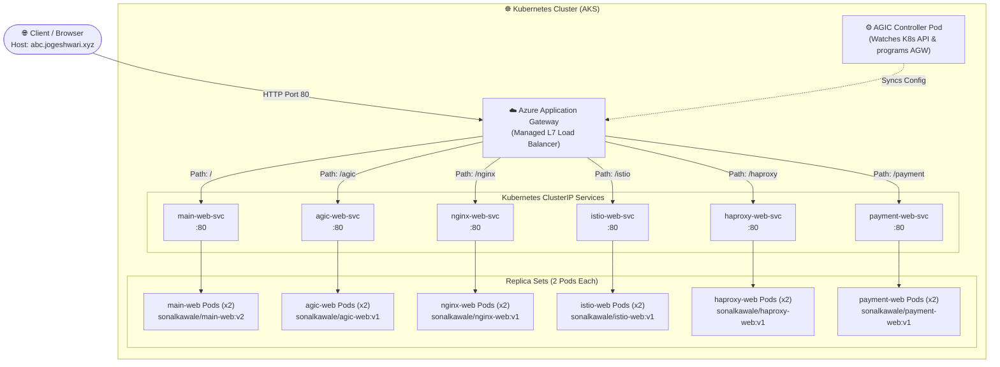

# ☸️ Kubernetes Ingress Controllers Master Hub & Multi-Service Practice Lab

[](https://kubernetes.io/)
[](https://www.docker.com/)
[](https://azure.github.io/application-gateway-kubernetes-ingress/)
[](https://nginx.org/)
[]()
[](LICENSE)

A production-style Kubernetes demonstration project showcasing **Layer 7 path-based routing**, microservice containerization, and in-depth architectural guides for the industry's four leading Kubernetes Ingress controllers (**Azure AGIC**, **NGINX Ingress**, **Istio Service Mesh Gateway**, and **HAProxy Ingress**), complemented by an interactive **Payment Gateway** demo application.

---

## 📑 Table of Contents

- [Overview](#-overview)
- [Architecture & Traffic Flow](#-architecture--traffic-flow)
- [Microservices & Routing Matrix](#-microservices--routing-matrix)
- [Ingress Controller Comparison](#-ingress-controller-comparison)
- [Repository Structure](#-repository-structure)
- [Prerequisites](#-prerequisites)
- [Quick Start & Deployment](#-quick-start--deployment)
- [DNS & Host Resolution](#-dns--host-resolution)
- [Testing & Verification](#-testing--verification)
- [Adapting for Other Ingress Controllers](#-adapting-for-other-ingress-controllers)
- [Building & Pushing Docker Images](#-building--pushing-docker-images)
- [Troubleshooting](#-troubleshooting)
- [Author & Credits](#-author--credits)

---

## 🌟 Overview

Modern cloud-native platforms rely on **Kubernetes Ingress Controllers** to expose internal, ephemeral microservices securely behind a unified entry point. 

This repository provides an end-to-end practical blueprint:
- **Unified Edge Routing**: Routes client requests through a single domain (`abc.jogeshwari.xyz`) using Layer 7 path prefix rules.
- **Path Rewriting**: Employs `appgw.ingress.kubernetes.io/backend-path-prefix: "/"` so downstream microservices receive clean requests at root `/`.
- **Educational Deep Dives**: Bundles interactive, responsive web applications detailing configuration snippets, use cases, pros & cons, and internal mechanics of major ingress controllers.
- **Microservice Isolation**: Demonstrates modular container deployments with explicit CPU/memory requests, limits, and dedicated `ClusterIP` services.

---

## 📐 Architecture & Traffic Flow



### Traffic Lifecycle
1. The user navigates to `http://abc.jogeshwari.xyz/<path>`.
2. Public DNS resolves `abc.jogeshwari.xyz` to the **Azure Application Gateway Public IP**.
3. Application Gateway evaluates Ingress routing rules defined in [`ingress.yaml`](ingress.yaml).
4. The path rewrite annotation (`backend-path-prefix: "/"`) strips the path prefix before forwarding the HTTP request.
5. Traffic hits the corresponding `ClusterIP` Service on port 80 and is load-balanced across the healthy container Pods.

---

## 📊 Microservices & Routing Matrix

The cluster hosts **6 microservices** (12 pods total) with standardized resource requests and limits:

| URL Path | Service Name | Deployment Name | Replicas | Docker Image | Requests (CPU / Mem) | Limits (CPU / Mem) | Description |
|:---|:---|:---|:---:|:---|:---:|:---:|:---|
| `/` | `main-web-svc` | `main-web-deployment` | 2 | `sonalkawale/main-web:v2` | `50m` / `64Mi` | `250m` / `128Mi` | Master Ingress Hub dashboard with core ingress architectural theory and portal links. |
| `/agic` | `agic-web-svc` | `agic-web-deployment` | 2 | `sonalkawale/agic-web:v1` | `50m` / `64Mi` | `250m` / `128Mi` | In-depth guide on Azure Application Gateway Ingress Controller & CNI pod routing. |
| `/nginx` | `nginx-web-svc` | `nginx-web-deployment` | 2 | `sonalkawale/nginx-web:v1` | `50m` / `64Mi` | `250m` / `128Mi` | Architecture, annotations, Lua plugins, and ingress-nginx patterns. |
| `/istio` | `istio-web-svc` | `istio-web-deployment` | 2 | `sonalkawale/istio-web:v1` | `50m` / `64Mi` | `250m` / `128Mi` | Envoy-based service mesh edge gateway, Gateway/VirtualService CRDs, and mTLS security. |
| `/haproxy` | `haproxy-web-svc` | `haproxy-web-deployment` | 2 | `sonalkawale/haproxy-web:v1` | `50m` / `64Mi` | `250m` / `128Mi` | High-throughput, ultra-low-latency edge proxying, runtime API, and DDoS mitigation. |
| `/payment` | `payment-web-svc` | `payment-web-deployment` | 2 | `sonalkawale/payment-web:v1` | `50m` / `64Mi` | `250m` / `128Mi` | Interactive simulated Payment Gateway checkout UI demonstrating live path routing. |

---

## ⚖️ Ingress Controller Comparison

| Feature / Trait | Azure AGIC | NGINX Ingress | Istio Ingress Gateway | HAProxy Ingress |
|:---|:---|:---|:---|:---|
| **Data Plane Engine** | Azure Application Gateway (Managed) | NGINX Open-Source | Envoy Proxy | HAProxy Core |
| **Execution Model** | External Cloud Load Balancer (Out-of-cluster) | In-cluster Pods (DaemonSet or Deployment) | In-cluster Envoy Pods (Service Mesh Boundary) | In-cluster Pods |
| **Pod Direct Routing** | ✅ Yes (routes directly to Pod IPs via Azure CNI) | ⚠️ Via ClusterIP/Endpoints | ⚠️ Via Envoy sidecars & mesh endpoints | ⚠️ Via Endpoints / ClusterIP |
| **Configuration** | Ingress resource + Azure annotations | Ingress resource + Nginx annotations | Custom Resources (`Gateway`, `VirtualService`) | Ingress resource + HAProxy annotations |
| **WAF Integration** | ✅ Native Azure WAF v2 (OWASP Top 10) | ⚠️ ModSecurity / App Protect (requires setup) | ⚠️ Envoy Wasm / Coraza filters | ⚠️ ModSecurity / SPOE plugins |
| **Traffic Splitting (Canary)** | Basic weight annotations | Annotation-based canary (`canary-by-header`, etc.) | ✅ Native granular percentage splitting in `VirtualService` | Annotation-based canary |
| **Zero-Trust Security (mTLS)** | Cloud TLS termination | Edge TLS termination | ✅ Automatic end-to-end mTLS across all mesh pods | Edge TLS termination |
| **Best Suited For** | Azure AKS enterprise deployments needing cloud-managed WAF | Universal, multi-cloud standard; most widely supported | Microservice meshes needing advanced observability & mTLS | Extreme packet performance, low memory footprint, and massive concurrency |

---

## 📁 Repository Structure

```text
kubernetes_practice/
├── agic-web/                    # AGIC deep-dive microservice
│   ├── Dockerfile               # Nginx Alpine container definition
│   └── index.html               # Responsive documentation page for AGIC
├── haproxy-web/                 # HAProxy deep-dive microservice
│   ├── Dockerfile
│   └── index.html               # Responsive documentation page for HAProxy
├── istio-web/                   # Istio Gateway deep-dive microservice
│   ├── Dockerfile
│   └── index.html               # Responsive documentation page for Istio
├── main-web/                    # Central Master Hub portal
│   ├── Dockerfile
│   └── index.html               # Master dashboard with overview & navigation cards
├── nginx-web/                   # NGINX Ingress deep-dive microservice
│   ├── Dockerfile
│   └── index.html               # Responsive documentation page for NGINX
├── payment-web/                 # Interactive payment checkout microservice
│   ├── default.conf             # Custom Nginx configuration routing / and /payment
│   ├── Dockerfile
│   └── index.html               # Interactive checkout demo UI
├── deployment.yaml              # Kubernetes Deployments for all 6 microservices (12 pods)
├── ingress.yaml                 # Layer 7 Ingress routing manifest (AGIC controller)
├── service.yaml                 # Kubernetes ClusterIP Services for all 6 microservices
└── README.md                    # Project documentation
```

---

## 🛠️ Prerequisites

Before deploying this repository to a cluster, ensure you have:

1. **Kubernetes Cluster**: An active Kubernetes cluster (v1.20+)
   - *Recommended*: Azure Kubernetes Service (AKS) with the **Application Gateway Ingress Controller (AGIC)** addon enabled.
   - *Alternative*: Any local or cloud Kubernetes cluster (Minikube, Kind, K3s, EKS, GKE) with an Ingress Controller installed.
2. **`kubectl` CLI**: Installed and configured to communicate with your target cluster.
3. **Docker** *(Optional)*: Required only if you intend to rebuild and publish custom container images.

---

## 🚀 Quick Start & Deployment

### 1. Clone the Repository

```bash
git clone https://github.com/sonalkawale3/kubernetes_practice.git
cd kubernetes_practice
```

### 2. Deploy All Resources to Kubernetes

You can apply all manifests in sequence:

```bash
# 1. Deploy the 6 microservice workloads (12 pods total)
kubectl apply -f deployment.yaml

# 2. Expose the workloads via internal ClusterIP Services
kubectl apply -f service.yaml

# 3. Apply the Layer 7 Ingress routing rules
kubectl apply -f ingress.yaml
```

*Or apply the entire directory at once:*

```bash
kubectl apply -f .
```

### 3. Verify Deployment Status

Verify that all pods, services, and the ingress resource are running:

```bash
# Check Pods (should show 12 pods Running)
kubectl get pods -o wide

# Check Services (should show 6 ClusterIP services on port 80)
kubectl get svc

# Check Ingress status and retrieve public IP
kubectl get ingress jogeshwari-ingress
```

Sample output:
```text
NAME                 CLASS                      HOSTS                ADDRESS         PORTS   AGE
jogeshwari-ingress   azure-application-gateway   abc.jogeshwari.xyz   20.219.100.45   80      2m
```

---

## 🌐 DNS & Host Resolution

The Ingress is configured for the host: **`abc.jogeshwari.xyz`**.

To test the application from your local workstation:

### Option A: Local Hosts File (Recommended for Testing)

Map the public IP of your Ingress Controller / Application Gateway to `abc.jogeshwari.xyz`:

1. Obtain your Ingress IP:
   ```bash
   kubectl get ingress jogeshwari-ingress -o jsonpath="{.status.loadBalancer.ingress[0].ip}"
   ```

2. Add an entry to your operating system's `hosts` file:
   - **Linux / macOS**: `/etc/hosts`
   - **Windows**: `C:\Windows\System32\drivers\etc\hosts` (run Notepad as Administrator)

   ```text
   <YOUR_INGRESS_PUBLIC_IP>   abc.jogeshwari.xyz
   ```

3. Open your browser and navigate to:
   - **Main Hub**: `http://abc.jogeshwari.xyz/`
   - **AGIC Guide**: `http://abc.jogeshwari.xyz/agic`
   - **NGINX Guide**: `http://abc.jogeshwari.xyz/nginx`
   - **Istio Guide**: `http://abc.jogeshwari.xyz/istio`
   - **HAProxy Guide**: `http://abc.jogeshwari.xyz/haproxy`
   - **Payment Demo**: `http://abc.jogeshwari.xyz/payment`

---

### Option B: Quick CLI Test with `curl`

If you do not wish to edit your `hosts` file, test directly using `curl` with a custom Host header:

```bash
export INGRESS_IP=$(kubectl get ingress jogeshwari-ingress -o jsonpath="{.status.loadBalancer.ingress[0].ip}")

# Test Main Hub
curl -H "Host: abc.jogeshwari.xyz" http://$INGRESS_IP/

# Test Payment Microservice
curl -H "Host: abc.jogeshwari.xyz" http://$INGRESS_IP/payment
```

---

## 🔍 Testing & Verification

Run these diagnostic commands to inspect the cluster components:

```bash
# Describe Ingress rules and backend mapping
kubectl describe ingress jogeshwari-ingress

# Check endpoints for all services to verify healthy pod registration
kubectl get endpoints

# Inspect logs of a specific microservice pod
kubectl logs -l app=main-web --tail=50
kubectl logs -l app=payment-web --tail=50

# Check AGIC controller pod synchronization logs (in kube-system or agic namespace)
kubectl logs -l app=ingress-azure -n kube-system --tail=100
```

---

## 🔄 Adapting for Other Ingress Controllers

If you are running in an environment without Azure AGIC (e.g. Minikube, Kind, or a vanilla cluster with **ingress-nginx**), update [`ingress.yaml`](ingress.yaml) as follows:

```yaml
apiVersion: networking.k8s.io/v1
kind: Ingress
metadata:
  name: jogeshwari-ingress
  annotations:
    # NGINX-specific rewrite annotation replacing the AGIC backend-path-prefix
    nginx.ingress.kubernetes.io/rewrite-target: /$2
    nginx.ingress.kubernetes.io/use-regex: "true"
spec:
  ingressClassName: nginx
  rules:
  - host: abc.jogeshwari.xyz
    http:
      paths:
      - path: /agic(/|$)(.*)
        pathType: ImplementationSpecific
        backend:
          service:
            name: agic-web-svc
            port:
              number: 80
      - path: /nginx(/|$)(.*)
        pathType: ImplementationSpecific
        backend:
          service:
            name: nginx-web-svc
            port:
              number: 80
      - path: /istio(/|$)(.*)
        pathType: ImplementationSpecific
        backend:
          service:
            name: istio-web-svc
            port:
              number: 80
      - path: /haproxy(/|$)(.*)
        pathType: ImplementationSpecific
        backend:
          service:
            name: haproxy-web-svc
            port:
              number: 80
      - path: /payment(/|$)(.*)
        pathType: ImplementationSpecific
        backend:
          service:
            name: payment-web-svc
            port:
              number: 80
      - path: /(.*)
        pathType: ImplementationSpecific
        backend:
          service:
            name: main-web-svc
            port:
              number: 80
```

---

## 📦 Building & Pushing Docker Images

Each microservice is standalone and self-contained. To build and publish your own images:

```bash
# Replace YOUR_DOCKERHUB_USERNAME with your Docker Hub handle
export DOCKER_USER="sonalkawale"

# 1. Main Web Hub
docker build -t $DOCKER_USER/main-web:v2 ./main-web
docker push $DOCKER_USER/main-web:v2

# 2. AGIC Web
docker build -t $DOCKER_USER/agic-web:v1 ./agic-web
docker push $DOCKER_USER/agic-web:v1

# 3. NGINX Web
docker build -t $DOCKER_USER/nginx-web:v1 ./nginx-web
docker push $DOCKER_USER/nginx-web:v1

# 4. Istio Web
docker build -t $DOCKER_USER/istio-web:v1 ./istio-web
docker push $DOCKER_USER/istio-web:v1

# 5. HAProxy Web
docker build -t $DOCKER_USER/haproxy-web:v1 ./haproxy-web
docker push $DOCKER_USER/haproxy-web:v1

# 6. Payment Web
docker build -t $DOCKER_USER/payment-web:v1 ./payment-web
docker push $DOCKER_USER/payment-web:v1
```

---

## ❓ Troubleshooting

### 1. Ingress returns `502 Bad Gateway`
- **Cause**: The backend Pods are not passing health probes or are failing to start.
- **Fix**: Check `kubectl get pods` to ensure pods are `Running`. Check pod logs using `kubectl logs <pod-name>`.

### 2. Ingress `ADDRESS` is empty / pending
- **Cause**: The Ingress Controller (e.g. AGIC or ingress-nginx) is not installed, not running, or lacks permissions to update Azure Application Gateway.
- **Fix**: Inspect the AGIC controller pod logs in `kube-system`:
  ```bash
  kubectl get pods -n kube-system -l app=ingress-appgw
  kubectl logs -n kube-system -l app=ingress-appgw --tail=50
  ```

### 3. Path routes return `404 Not Found`
- **Cause**: The downstream Nginx container is receiving the prefixed URI (e.g. `/payment`) instead of `/`, but Nginx is configured to serve static assets from `/usr/share/nginx/html` at `/`.
- **Fix**: Verify that the annotation `appgw.ingress.kubernetes.io/backend-path-prefix: "/"` is present in [`ingress.yaml`](ingress.yaml). In `payment-web`, ensure [`payment-web/default.conf`](payment-web/default.conf) includes location blocks for both `/` and `/payment`.

---

## 👤 Author & Credits

- **Repository Maintainer**: [sonalkawale3](https://github.com/sonalkawale3)
- **Project**: Kubernetes Practice & Ingress Controller Architecture Lab
- **Domain**: `abc.jogeshwari.xyz`
